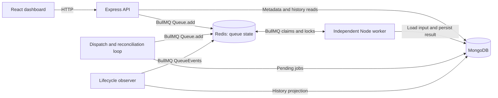
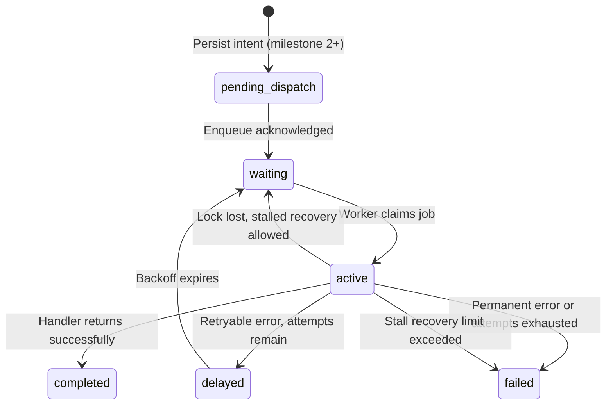

# JobPulse architecture

Implementation update: CSV imports and local MongoDB now extend the original simulation milestone. See [CSV implementation architecture](csv-imports.md) and the [README](../README.md) for actual endpoints, storage, limits and tests. The sections below remain the broader proposed design; outbox dispatch, React, authentication and several monitoring features are not implemented.

## Basis and boundaries

This is a proposed architecture for the requirements in [project-spec.md](project-spec.md). The blueprint PDF could not be extracted in this environment; no decisions here are attributed to its unread contents. Start with a modular codebase and independently running API and worker processes. Sharing source code is compatible with independent deployment: a process boundary, not a separate repository, lets workers continue when the API restarts.

## Components and communication



The first milestone uses only API, Redis, and worker. The dispatch loop and observer are later logical components; they can initially run inside the API process with explicit lifecycle management. A small periodic reconciliation pass provides recovery if an event or process is lost. Multiple API replicas eventually require safe coordination of these loops.

| Component | Owns | Why this boundary exists |
| --- | --- | --- |
| Express API | HTTP validation, supported job types, submission, read APIs, later access control | Requests stay short and business work does not consume the request lifetime |
| BullMQ Queue | Producer interface to add jobs and inspect scheduling state | Library code coordinates queue operations; application code should not manipulate Redis queue keys |
| Worker | Claiming jobs, running handlers, progress, durable results, throwing execution errors | Work can scale and restart independently from the API |
| Redis | BullMQ waiting/delayed/active/completed/failed data, locks, queue events | A shared coordination store lets several workers safely compete for jobs under normal conditions |
| MongoDB | Immutable submitted input, application identity, results, history, dispatch intent | Supports durable user queries and retention independently of queue cleanup |
| React | Submission and monitoring UI | Presents server state without owning scheduling or trusted execution logic |

BullMQ is a library using Redis, not another server to deploy. Redis is operational queue infrastructure, so treating it as a disposable cache would lose pending work. MongoDB does not choose which worker runs next. These responsibilities prevent two components from becoming competing schedulers.

## Job lifecycle



`pending_dispatch` is an application state, not a BullMQ state. Milestone 1 starts at `waiting`. `queued` in the POST receipt means enqueue was acknowledged; it is not an additional BullMQ state. A retryable attempt error does not necessarily mean the whole job is terminally failed. Stalling is an event/recovery condition, not a permanent state. BullMQ can recover jobs whose worker stops renewing its lock; see [stalled jobs](https://docs.bullmq.io/guide/jobs/stalled).

Normal execution after history is added:

1. API validates an allowlisted job type and bounded input, assigns a UUID, and saves immutable input in MongoDB.
2. API adds that ID to `jobpulse-jobs`, then returns an acceptance receipt.
3. A worker claims the job using BullMQ. Its lock is renewed while the handler runs.
4. The worker loads the input, performs the task, and persists the small result idempotently by job ID before returning it to BullMQ.
5. BullMQ records completion after the handler returns. Lifecycle observation updates MongoDB's execution projection; reconciliation repairs missed updates.
6. React reads the API. The API reports current queue state when available alongside history and observation timestamps. If Redis is unavailable, it labels cached history as stale; it must not report invented live state.

Result persistence and BullMQ completion are separate writes too. A crash after saving a result but before completion can trigger another execution. The handler must recognize an already committed result and return it safely. Avoid writing `completed` optimistically in MongoDB before BullMQ has completed its own transition.

## Delivery guarantees and idempotency

Design handlers for **at-least-once execution**: one logical job may run more than once. For example, a worker can finish an external operation, lose its connection before acknowledging completion, and have its job recovered. A queue lock reduces overlapping work but is not a universal exactly-once guarantee. A stale worker can continue running after losing its lock.

An idempotent operation produces the same intended final effect when repeated. The initial deterministic demo makes this easy. For future external actions, use the downstream provider's idempotency key or a durable business-operation key. A MongoDB `completed` flag alone cannot prevent a duplicate external email or payment across a crash. If a provider offers no deduplication, document that limitation before enabling that job type. See [BullMQ's idempotent-job guidance](https://docs.bullmq.io/patterns/idempotent-jobs).

Use three distinct concepts:

- HTTP idempotency keys deduplicate repeated client submissions.
- A stable BullMQ `jobId` suppresses duplicate queue insertion while that queue record exists.
- An idempotent handler protects business effects even if execution repeats.

Queue deduplication does not last after the corresponding job record is removed. Use UUID strings without `:` for custom BullMQ IDs. Retain records through the dispatch/reconciliation recovery window and define retention before cleanup is enabled.

## The MongoDB-to-Redis consistency gap

Saving a MongoDB document and adding a Redis job cannot be one ordinary database transaction. If the process crashes between the two operations, the document can exist without a queue job. Reversing the writes creates the opposite problem: executable work without its history/input record.

Milestone 3 uses the job document itself as a small outbox, meaning a durable record of work still needing dispatch:

1. Persist the immutable input and `dispatchStatus=pending` in one MongoDB document write, using a unique submission key where supplied.
2. Try `Queue.add` with `jobId` equal to the document UUID and the configured retry policy.
3. After acknowledgement, update only dispatch fields to `enqueued`; do not reset execution fields to waiting, since the worker may already be active or finished.
4. A bounded periodic loop retries pending documents with the same ID. A crash after enqueue but before step 3 is safe to retry while the queue record remains present.
5. Use a dispatch lease/conditional update to avoid redundant dispatchers as replicas are added. Keep handler idempotency even with leases, since they can expire.

With this path, `202` can mean durable acceptance while dispatch is pending; include `status: "pending_dispatch"` in that case. If persistence fails, return `503`. An ambiguous response can be retried using the same HTTP key. Do not tell clients that a durable pending submission was rejected simply because Redis is temporarily down.

This design repairs the submission crash gap, not every possible Redis data-loss event. Reconciliation compares unfinished documents with queue state. Redis loss can erase evidence of an operation already executed, so replay requires idempotent handlers and an explicit operator recovery policy. Do not blindly re-enqueue every historic MongoDB document.

## Failure handling

| Failure | Proposed behavior and reason |
| --- | --- |
| Invalid request | Reject before persistence or enqueue; retrying unchanged input cannot help |
| Temporary execution error | Throw an `Error`; use 3 total attempts with exponential backoff starting at 1 second; cap work per attempt and measure retries |
| Permanent execution error | Fail without automatic retry using the supported BullMQ unrecoverable-error mechanism; preserve a sanitized reason |
| Attempts exhausted | Retain the failed job and MongoDB history for inspection; failed jobs act as the initial dead-letter collection, with no second queue needed |
| Worker crash or lost lock | Allow BullMQ stalled-job recovery with an explicit bounded stall limit, initially 1; assume duplicate work is possible |
| Redis unavailable | Early milestones return bounded submission errors; durable-dispatch milestone accepts only after MongoDB persistence and reports pending dispatch; workers reconnect |
| MongoDB unavailable | Once MongoDB owns input/results, reject new durable submissions; workers throw on required reads/writes and use bounded retries, preserving queue failures for inspection |
| Missed/out-of-order event | Reconcile with current BullMQ state rather than applying old event payloads blindly; make updates conditional and label observation times |
| Process shutdown | Stop accepting new work, close the worker gracefully, then close queue/database connections; termination grace must cover expected active work |

The retry count includes the initial attempt. Backoff spreads retries over time so a recovering dependency is not immediately flooded. See [BullMQ retry semantics](https://docs.bullmq.io/guide/retrying-failing-jobs). A terminal failure needs diagnosis; increasing retries indefinitely hides an outage. Manual retry controls are deferred until they can be authorized, audited, and protected against duplicate effects.

Do not swallow handler exceptions and return a success object: BullMQ interprets a normal return as success. Attach process/worker error listeners for infrastructure errors separately from job failures. Use structured logs with request ID, job ID, attempt, worker identity, duration, and safe error code.

Long synchronous CPU work blocks Node's event loop, including lock renewal. Begin with bounded asynchronous work. If CPU-heavy jobs are introduced, move their execution to worker threads or sandboxed processors. A timeout should cancel the underlying operation where possible; merely rejecting a `Promise.race` does not stop a side effect still running.

## Connections, durability, and scaling

Keep Redis producer and worker connection policies separate. HTTP enqueue should have a bounded failure path; workers are long-lived and should reconnect. Verify exact connection requirements against the pinned BullMQ version when implementing, including connections needed by event observers. Do not share one connection configuration indiscriminately across every component.

Use persistent Redis storage with an explicitly chosen persistence policy and a queue-compatible no-eviction configuration. A named Docker volume preserves files across container replacement; persistence settings determine which writes reach those files. Volumes alone do not eliminate data-loss windows. MongoDB also needs persistent storage and eventual backup/restore exercises. Do not promise zero loss from a single Redis or MongoDB instance.

Start with worker concurrency 1, then run two independent workers against the same Redis queue to demonstrate distribution. Increase concurrency for measured I/O-bound workloads; more concurrency does not create more CPU. FIFO waiting order does not imply completion order across multiple workers or retries. Introduce separate queues only when task types need different resources or isolation.

Record queue depth, oldest waiting age, enqueue-to-start delay, execution duration, retry count, terminal failure count, and stalled events. A growing backlog can indicate worker capacity or dependency trouble; average duration alone can hide it. Derive live queue counts from Redis and historical analysis from MongoDB, with explicit retention and observation times.

## Suggested source layout (future implementation)

```text
apps/api/                 Express entry point, routes, validation
apps/worker/              Independent worker entry point and handlers
apps/web/                 React dashboard
packages/shared/          Job schema, queue name, configuration contracts
packages/persistence/     MongoDB models and conditional updates
infra/                    Dockerfiles and Compose configuration
docs/                     Specification, architecture, operational notes
```

These are logical boundaries, not a requirement to adopt a monorepo framework. Start with the simplest package setup that gives the API and worker separate commands. This documentation step creates no application scaffolding.
