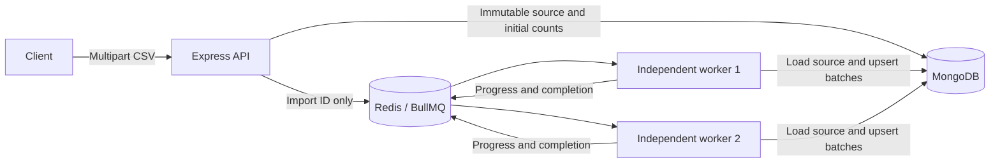

# CSV imports: implemented architecture

This extends the original simulation milestone. The README describes runnable commands; earlier blueprint/spec documents remain proposals beyond the implemented scope.

## Responsibilities and data flow

The API validates the upload envelope and text encoding, persists the input, then enqueues its ID. The worker validates CSV syntax/schema, classifies rows, writes valid records in batches, and publishes counters. BullMQ/Redis owns scheduling, locks and retry state. MongoDB owns the immutable input, accepted records and durable counters. The same queue carries simulations and imports, with an explicit dispatcher allowing only those two handlers.

Source bytes are stored as MongoDB binary values. A 2 MB maximum keeps these comfortably below MongoDB's document limit and avoids local file paths or large Redis payloads. Multiple workers can load the same file without a shared filesystem. The parser exposes an iterator, but source uploads are buffered and parser output is bounded by row/file/record limits; this is not an unlimited streaming upload system.

## Important functions

| File/function | Purpose |
| --- | --- |
| `src/imports/routes.js` / `importRoutes` | Applies multipart limits, stores the source before enqueue, and serves durable summaries |
| `src/imports/csv.js` / `validateFileBytes` | Rejects empty/oversized input, invalid UTF-8 and NUL bytes |
| `src/imports/csv.js` / `importIdFor` | Hashes schema version and exact source bytes, giving all retries/workers the same identity |
| `src/imports/csv.js` / `csvRows` | Checks exact header, parses records and enforces CSV/row limits |
| `src/imports/csv.js` / `validateRow` | Converts only approved fields into typed MongoDB records, or rejects a row |
| `src/imports/processor.js` / `processCsvImport` | Processes batches of 100 input records, counts outcomes, checkpoints and classifies exceptions |
| `src/imports/processor.js` / `isTransientFailure` | Recognizes network/server-selection and selected retryable server failures |
| `src/imports/store.js` / `createImportStore` | Lazily connects MongoDB, establishes the unique index and provides idempotent storage operations |
| `src/processor.js` / `createJobProcessor` | Dispatches simulation/CSV jobs without dynamic imports or user-supplied code |
| `src/worker.js` | Runs one independent consumer, logs job/process identity, drains before shutdown |

## Stored data

`imports` documents use `_id=importId` (MongoDB's unique primary key) with:

- Immutable `source` bytes and `schemaVersion`.
- `createdAt`, `processed`, `accepted`, `rejected`, `finished`.

`records` documents contain `importId`, `rowNumber`, `name`, `email`, `age`, plus MongoDB's `_id`. A compound **unique** index on `(importId, rowNumber)` enforces row identity. Row number means the ordinal nonblank data record, not physical line number, since quoted CSV fields can span lines.

The import ID is SHA-256 over a version prefix and exact file bytes. Including schema version avoids reusing row identities after a future incompatible validation change. Two uploads with different filenames but identical bytes share an import. Two different inputs may contain the same email: global business deduplication is deliberately separate from execution idempotency.

## Batch processing and counters

Every batch covers at most 100 input rows. Only valid rows generate bulk-write operations; rejected rows increment a counter. `processed = accepted + rejected`. All-invalid files can complete successfully with zero accepted rows.

The worker uses `updateOne` upserts with `$setOnInsert`, not insert-only batches or counter increments. A replay leaves existing immutable records unchanged. Writes precede the MongoDB checkpoint, which precedes progress publication. If a write partially commits and throws, that batch has no successful checkpoint; the next attempt starts from the beginning and safely upserts those identities again.

Counters are recalculated from the immutable input on every attempt. MongoDB uses `$max` for each counter, so repeated or overlapping attempts cannot inflate or regress them. `finished=true` is set only after the whole input has been processed. A stale attempt never resets it to false. BullMQ progress is a per-attempt observation and may lag/reset; MongoDB counters are durable monotonic checkpoints. Neither is a transaction with queue completion.

## Failure and retry policy

CSV jobs have three total attempts with exponential backoff: a 1-second delay before the second attempt and a 2-second delay before the third. Simulation jobs retain one execution attempt. Stalled-job recovery remains separate, with the existing limit of one recovery.

| Failure | Outcome |
| --- | --- |
| Invalid row values/field count | Count as rejected and continue |
| Malformed CSV, wrong header, row/record limit, empty data | `UnrecoverableError`; no automatic retry |
| Missing/corrupt immutable source or unsupported job | Permanent failure |
| Recognized MongoDB/network transient failure | Throw to BullMQ; bounded retry/backoff |
| MongoDB unique-key race on identical upserts | Treat as already present; propagate other write/write-concern failures |
| Unknown programming/non-transient error | Permanent sanitized failure; investigate logs |
| Exhausted attempts | Retained BullMQ failed record and any previously persisted rows/checkpoints |

BullMQ locks reduce normal concurrent execution, but a worker can lose its lock after writing. Another worker may then execute the job. The unique database constraint, rather than the lock alone, protects records. This is **at-least-once processing with idempotent writes**, not exactly-once execution.

The integration fault wrapper exists only in `test/helpers/import-worker.js`. It deliberately throws a network error after actual MongoDB writes, modelling a lost acknowledgement. Tests verify that retries execute, backoff increases, and committed rows do not multiply. They do not claim a real database outage occurred or publish throughput benchmarks.

## Upload safety

The API allows one file named `file`, limits file bytes and multipart parts/fields, and admits at most four uploads per process. CSV extension/MIME checks are combined with UTF-8/NUL checks and real worker-side parsing. Original filenames are not used for storage or paths. Files are not served back as executable/static assets.

The CSV header is fixed; unknown column names never become object/database keys. MongoDB operators are constructed in server code. Raw source and parser error contents are excluded from HTTP errors and ordinary logs. The application never executes CSV formulas or user-supplied code. If spreadsheet export is introduced, formula-looking values need escaping at that boundary.

These limits support local use, not comprehensive denial-of-service protection. There is no authentication or multi-user authorization. API and database ports bind to loopback.

## Known limitations

1. MongoDB source persistence and Redis enqueue are separate writes. HTTP 202 means both were acknowledged; an error can have an ambiguous outcome. Resubmitting identical bytes retries dispatch safely while preserving identity. There is no automatic outbox dispatcher, so never-resubmitted sources can remain undispatched.
2. Imports are not all-or-nothing. Committed batches remain after failure. Retrying is safe, but rollback and atomic cross-store completion are not implemented. Counters can lag committed rows after a crash.
3. Sources and queue jobs are retained indefinitely. Re-uploading a terminal failed job returns its existing ID/state rather than resetting attempts. There is no audited manual retry or retention workflow yet.
4. The input is small and buffered; larger uploads need streamed object/file storage and different limits. Workers independently hold source buffers. One shared queue means slow imports can delay simulations; resource-specific queues are a possible next step.
5. There is one Redis and one MongoDB instance. Volumes/AOF support local restart recovery, not high availability or zero data loss. Redis loss needs explicit recovery policy; blindly replaying every historic import is not implemented.
6. No artificial processing delay is added to real imports. Small files may finish before polling catches an intermediate state.
7. MongoDB Community uses the free-to-run SSPL, a source-available license rather than an OSI-approved open-source license. The preserved Redis 7.4 image also has source-available licensing. These are the specifically requested/existing components; no Atlas, paid hosting, API or cloud service is used. Strict OSI-only licensing would require separately agreed component/version changes. See [MongoDB's license FAQ](https://www.mongodb.com/legal/licensing/server-side-public-license/faq) and [Redis 7.4 licensing](https://redis.io/blog/redis-adopts-dual-source-available-licensing/).

## References

- [BullMQ retry behavior](https://docs.bullmq.io/guide/retrying-failing-jobs)
- [BullMQ permanent failures](https://docs.bullmq.io/patterns/stop-retrying-jobs)
- [CSV parsing options](https://csv.js.org/parse/options/)
- [MongoDB bulk writes](https://www.mongodb.com/docs/drivers/node/current/crud/bulk-write/)
