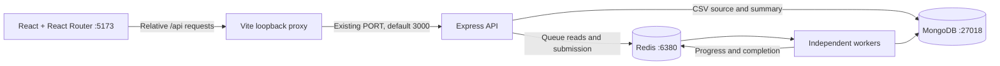

# React operations console

## Local architecture



The frontend never connects to Redis or MongoDB. The reusable fetch layer calls existing backend routes and the minimal added read endpoints. Vite's local proxy avoids needing permissive CORS on the unauthenticated API. Both development and production-build preview bind to `localhost:5173` with a strict port. Express remains loopback-only.

Root environment names are unchanged: `PORT`, `REDIS_URL`, `MONGODB_URL`. Vite reads only `PORT` for the server-side proxy target. Database URLs are not exposed through browser environment variables or embedded in the bundle. There is no hosting, cloud integration or external font dependency.

## Pages and reusable components

- **Dashboard**: `GET /queue` counts and `GET /jobs` recent records. Four state counters, an actual queue-distribution visual, delayed counts, observed timestamp and recent jobs. No invented throughput, uptime, trend line or worker availability claim.
- **Submit job**: client file-size/extension/MIME/UTF-8 feedback, real multipart upload, existing simulation form, disabled pending states, server errors and navigation to the returned job ID. The browser normalizes accepted CSV MIME types for consistent OS behavior. Backend validation remains authoritative.
- **Job history**: server-side status/type filters, case-insensitive job ID/type search, URL-backed filters and pagination. Changing a filter resets the page. Search never scans CSV content.
- **Job details**: type, full/copyable ID, current state/progress, attempt counts, timestamps, safe errors and real result JSON. CSV jobs also load durable MongoDB counts. Nonterminal jobs poll every 1.5 seconds, including delayed retries; terminal jobs stop polling. Manual refresh remains available.
- **Results**: completed retained job summaries, type filters and pagination. CSV counts are taken from the actual handler result. There are no download controls because no download endpoint exists.

`web/src/api.js` owns requests, status-aware errors, cancellation, a 10-second request timeout, multipart handling and client validation. `useResource.js` owns cancellable data loading, non-overlapping polling, manual refresh and stale-response protection when route/filter keys change. A failed refresh preserves existing data while reporting its error. New pages show a loader, not fabricated zero values.

`Layout.jsx` provides the responsive sidebar, mobile toggle, skip link, route focus and local-workspace framing. `components.jsx` shares status badges, type icons, tables, progress, empty/error/loading states and pagination. Page components compose those pieces. `styles.css` defines the visual system, responsive layouts, keyboard focus and reduced-motion behavior. Icons come from the local `lucide-react` package.

CSV progress has no known denominator while parsing. The bar therefore represents the accepted/rejected split **among processed rows**, with explicit count labels; it does not pretend to show file completion percentage. Simulation progress continues to use the backend's 0–100 percentage.

## Backend read contracts

Existing submission contracts are preserved:

- `POST /api/v1/jobs`: `{type:"simulation", mode:"complete"|"fail"}` → HTTP 202 with `jobId`, `status`, `statusUrl`.
- `POST /api/v1/imports`: multipart `file` → HTTP 202 with `jobId`, `importId`, `status`, `statusUrl`.
- `GET /api/v1/imports/:id`: MongoDB summary, source bytes excluded, with `_id`, counters, `finished`, timestamps and `statusUrl`.

### Added: `GET /api/v1/queue`

```text
{
  queue,
  counts: { waiting, active, completed, failed, delayed, waitingChildren },
  total,
  paused,
  observedAt,
  source: "retained-bullmq-jobs"
}
```

Counts come from BullMQ. Waiting includes ordinary waiting, paused waiting and prioritized jobs. `total` includes every displayed state, including delayed and waiting-for-children. `paused` is the queue's actual paused flag. Successful reads indicate the queue/API responded; they do not establish worker health.

### Added: `GET /api/v1/jobs`

Query parameters:

| Parameter | Contract |
| --- | --- |
| `status` | Optional waiting, active, delayed, completed, failed or waiting-children |
| `type` | Optional simulation or csv-import |
| `search` | Optional literal case-insensitive ID/type substring, at most 128 characters |
| `page` | Positive integer, default 1 |
| `pageSize` | 1–50, default 15 |

Unknown, repeated, malformed and out-of-range query parameters return 400. Response:

```text
{ items: [publicJob], total, page, pageSize, truncated, limitPerState, observedAt }
```

Each request inspects at most **500 queue entries per raw state**, deduplicates jobs observed during state transitions, filters and sorts the inspected window by creation timestamp descending, and paginates it. This bounds Redis work for a local portfolio workload without adding another database projection/scheduler. Per-state retrieval order comes from BullMQ (list order or sorted-set score), so this is not an unrestricted global creation-time index.

`total` is the count matching filters in the inspected window. `truncated=true` warns that one or more raw queue states exceed 500 entries. The frontend visibly explains that window when necessary. `/queue` still counts **all retained** jobs. The list does not promise exhaustive lifetime search or stable pagination during concurrent submissions/transitions. A production-scale history index would require a separate durable projection and reconciliation design.

### Extended: `GET /api/v1/jobs/:id`

Existing fields remain: `jobId`, `state`, `progress`, `attemptsMade`, `result`, `error`.

Added fields are `type`, `maxAttempts`, `createdAt`, `startedAt`, `finishedAt`, and `retryBackoffMs`. Timestamps are epoch milliseconds or null. `retryBackoffMs` reports configured exponential backoff when delayed; it is not a promised retry execution timestamp. Attempts count finished attempts, not necessarily the currently executing one. Permanent failures may finish before `maxAttempts`.

Detail reads use BullMQ's current state and reload snapshot fields. List state comes from the inspected queue state set. Both are observations, not atomic transactions across Redis/MongoDB. Public serializers exclude input/stack traces and expose only allowlisted safe error messages. Read routes set `Cache-Control: no-store` and preserve sanitized 503 handling for infrastructure failures.

## Tests and boundaries

Backend tests cover count aggregation (including delayed/paused/prioritized states), list filtering/search/pagination, query validation, bounded history, metadata serialization and sanitized errors. Real-service integration tests verify these contracts alongside the original idempotency/retry behavior.

Browser tests use installed Chrome, the actual Express app on port 3001, Vite on 5173 and a worker using the production processor/store on unique real Redis/MongoDB namespaces. Test-only bootstraps select those namespaces without adding application environment variables or changing default queue behavior. Existing APIs/workers cannot claim these test jobs and are left running. Full flows submit real fixtures through the UI and preserve those isolated job/record results for inspection. A request-abort test verifies unavailable-API feedback; it does not inject fake dashboard data. Automated WCAG A/AA checks cover all five pages, including real completed CSV details/results; they are not a comprehensive accessibility certification.

This remains a local, single-user console without authentication. No queue mutation controls, file downloads, metrics-history store, production deployment or fabricated demonstration data were added. CSV data-loss/recovery limitations from [the import architecture](csv-imports.md) still apply.
